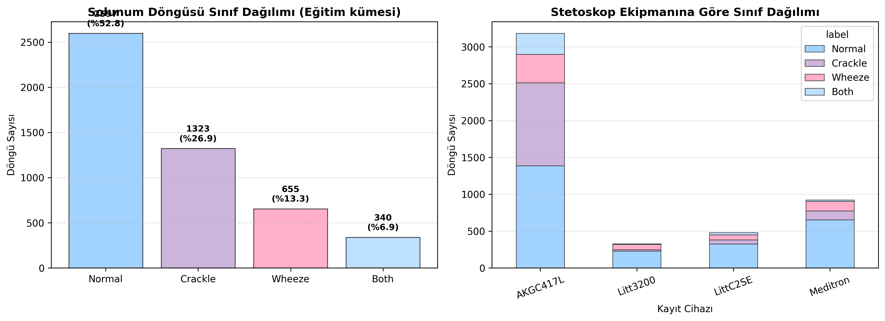
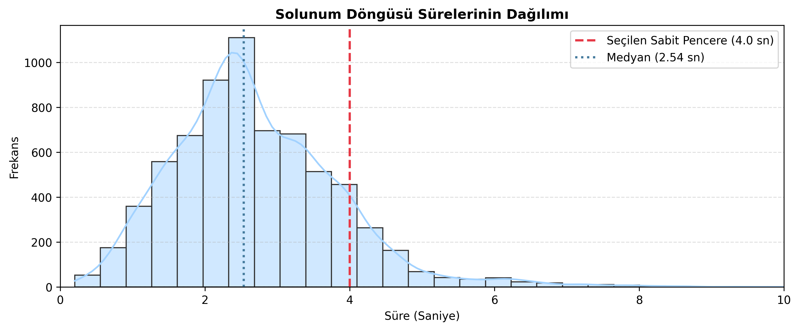
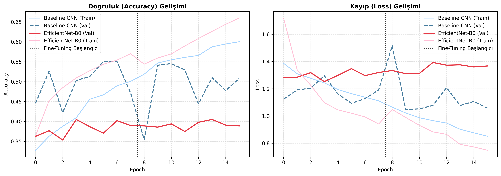
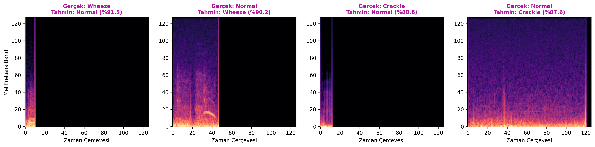

# Solunum Seslerindeki Akustik Örüntülerin CNN ve EfficientNet-B0 ile Sınıflandırılması

[](https://colab.research.google.com/github/esra03-1/icbhi-respiratory-sound-classification/blob/main/Solunum_Seslerinden_Patoloji_Siniflandirmasi.ipynb)


Bu projede dijital stetoskop kayıtlarından ayrıştırılan solunum döngüleri **Log-Mel spektrogramlara** dönüştürülür. Her döngü **Normal**, **Crackle (ral)**, **Wheeze (hırıltı)** veya **Both (ral ve hırıltı birlikte)** sınıfına atanır. Aynı hasta bazlı test kümesinde sıfırdan eğitilen bir 2D-CNN ile ImageNet ağırlıklarından başlatılan EfficientNet-B0 karşılaştırılır.

Proje, araştırma ve öğrenme amaçlı bir ses sınıflandırma deneyidir. **Normal** etiketi, ilgili döngüde crackle veya wheeze anotasyonu bulunmadığını ifade eder. Çalışmanın hasta düzeyinde tanı veya klinik kullanım için doğrulaması yapılmamıştır.

## 1. Veri Seti ve Ön İşleme

- **Veri kaynağı:** [ICBHI 2017 Respiratory Sound Database (Kaggle)](https://www.kaggle.com/datasets/vbookshelf/respiratory-sound-database).
- **Ham veri:** 126 hastaya ait 920 `.wav` kaydı ve bunlarla eşleşen 920 `.txt` anotasyon dosyasından 6.898 solunum döngüsü çıkarıldı.

| Sınıf | Ham döngü sayısı |
|---|---:|
| Normal | 3.642 |
| Crackle | 1.864 |
| Wheeze | 886 |
| Both | 506 |
| **Toplam** | **6.898** |

Başlangıç ve bitiş zamanları anotasyon dosyalarından okunarak kayıtlar solunum döngülerine ayrıldı. Süresi 0,2 saniyeden kısa olan döngü filtrelendikten sonra **6.897 döngü** kullanıldı.

`GroupShuffleSplit` ile aynı hastanın döngüleri tek bir kümede tutuldu. Hedef oranlar hasta gruplarına uygulandığı için döngü sayıları tam %70/%15/%15 oranında dağılmadı. Bu deneyde çalışmaya özgü bir hasta bölmesi kullanıldı.

| Küme | Hasta sayısı | Döngü sayısı |
|---|---:|---:|
| Eğitim | 88 | 4.915 |
| Doğrulama | 19 | 990 |
| Test | 19 | 992 |

Sesler **16 kHz** örnekleme hızına dönüştürüldü. Karşılaştırma için sabit tutulan **4 saniyelik** pencereye ulaşmak üzere kısa döngülerin sonuna sıfır eklendi ve uzun döngülerin ilk 4 saniyesi alındı. `librosa` ile **128 Mel bandı**, **1.024 örneklik analiz penceresi** ve **512 örneklik pencere kayması** kullanılarak Log-Mel spektrogramlar üretildi. Her spektrogram kendi minimum ve maksimum değerleriyle `[0, 1]` aralığına ölçeklendi. Aynı matris üç kanala kopyalanarak `(128, 126, 3)` boyutunda model girdisi elde edildi.

Aşağıdaki keşif grafikleri eğitim kümesindeki sınıf ve cihaz dağılımlarını, döngü sürelerini ve örnek ses temsillerini gösterir.






## 2. Model Mimarileri ve Eğitim

| Model | Yaklaşım |
|---|---|
| **Baseline 2D-CNN** | Dört konvolüsyon bloğuyla spektrogramdaki zaman ve frekans örüntülerini sıfırdan öğrenir. |
| **EfficientNet-B0** | ImageNet ağırlıklarıyla başlatılır. Önce omurga dondurularak sınıflandırıcı eğitilir, ardından omurganın son katmanlarının bir bölümü düşük öğrenme hızıyla ince ayara açılır. |
| **Çoğunluk sınıfı referansı** | Eğitim kümesindeki en sık sınıf olan Normal’i her örnek için tahmin eder. |

İki sinir ağında da sınıf dengesizliğinin eğitim kaybındaki etkisini azaltmak için yalnızca eğitim kümesinden hesaplanan ters frekans tabanlı `class_weight` kullanıldı. EfficientNet’in iki aşamasındaki en iyi ağırlıklar ayrı kaydedildi ve testte kullanılacak aşama **doğrulama kaybına** göre seçildi. İnce ayar sırasında omurganın ön eğitimli `BatchNormalization` istatistikleri korundu.



EfficientNet-B0’ın eğitim doğruluğu artarken doğrulama doğruluğu yaklaşık %35–41 aralığında kaldı. Eğitim ve doğrulama arasındaki bu fark, aşırı öğrenmeye işaret eder.

## 3. Test Sonuçları

Modeller, eğitim ve doğrulama kümelerinde yer almayan **19 hastaya ait 992 solunum döngüsü** üzerinde değerlendirildi. Sınıf dengesizliği nedeniyle doğruluğun yanında her sınıfa eşit ağırlık veren **Macro F1** ve sınıf bazlı recall değerleri incelendi.

| Model | Accuracy | Macro Precision | Macro Recall | Macro F1 | ROC-AUC (OvR) |
|---|---:|---:|---:|---:|---:|
| Çoğunluk sınıfı referansı | **0,5635** | 0,1409 | 0,2500 | 0,1802 | 0,5000 |
| Baseline 2D-CNN | 0,4869 | **0,3795** | 0,3550 | 0,3411 | **0,7141** |
| EfficientNet-B0 | 0,4254 | 0,3466 | **0,3640** | **0,3483** | 0,6597 |

- **Baseline 2D-CNN**, iki eğitilmiş model arasında doğruluk ve ROC-AUC bakımından öne çıktı. Normal ve Crackle sınıflarında daha yüksek recall elde etti.
- **EfficientNet-B0**, Wheeze örneklerinin **36/148’ini (%24,3)** ve Both örneklerinin **35/98’ini (%35,7)** doğru sınıflandırdı. CNN’de bu sayılar sırasıyla **19/148 (%12,8)** ve **13/98 (%13,3)** oldu. EfficientNet’in Macro F1 avantajı **0,0072** ile sınırlı kaldı.
- **Çoğunluk sınıfı referansı**, 992 örneğin 559’u Normal olduğu için **%56,35 doğruluk** elde etti. Diğer üç sınıfı hiç yakalayamadığından Macro F1 skoru **0,1802**’de kaldı. Her iki eğitilmiş model de Macro F1’de bu referansı geçti.


### Hata Analizi

EfficientNet-B0’ın en yüksek skorla yanlış sınıflandırdığı dört döngüden ikisi **0,300 ve 0,367 saniye** uzunluğundaydı. Bu örneklerin spektrogramlarında geniş sıfır dolgu alanları görüldü. Test kümesinin tamamında ise en kısa süre grubunun hata oranı daha düşüktü.

| Döngü süresi | Örnek sayısı | EfficientNet-B0 hata oranı |
|---|---:|---:|
| 1,5 saniye ve altı | 203 | %37,9 |
| 1,5 saniye üzeri, 4 saniyeye kadar | 735 | %62,4 |
| 4 saniye üzeri | 54 | %63,0 |

Dolgunun hataya etkisini ölçmek için aynı hasta bölmesinde farklı dolgu yöntemlerinin karşılaştırılması gerekir. Cihazlar arasında da hata oranları değişti. Örneğin LittC2SE grubunda hata oranı **%81,5** oldu, ancak bu gruptaki 65 döngü yalnızca **iki hastaya** aitti. Bu nedenle cihaz bazlı oranlar betimleyici olarak yorumlandı.



Sonuçlar tek bir hasta bölmesine ve bir eğitim çalıştırmasına dayanır. Macro F1’deki küçük farkın başka hasta gruplarında da görülüp görülmediğini değerlendirmek için hasta bazlı çapraz doğrulama veya bağımsız bir test kümesi gerekir.

## 4. Depo Yapısı

```text
assets/                                         # Veri keşfi, eğitim ve değerlendirme grafikleri
docs/
  INCELEME_VE_DUZELTMELER.md                     # İlk deneyin incelemesi ve kod düzeltmeleri
  DOGRULAMA.md                                   # Kod düzeltmelerine yönelik kontroller
Solunum_Seslerinden_Patoloji_Siniflandirmasi.ipynb
requirements-colab.txt                           # Colab bağımlılık aralıkları
README.md
.gitignore
```

## 5. Colab'da Çalıştırma

1. Üstteki **Open In Colab** düğmesiyle notebook’u açın ve çalışma zamanı türü olarak **T4 GPU** seçin.
2. Hücreleri yukarıdan aşağıya çalıştırın. Veri indirme hücresi istediğinde Kaggle’dan aldığınız `kaggle.json` dosyasını yalnızca çalışma oturumuna yükleyin.
3. Yaklaşık 3,7 GB boyutundaki arşivi indirmek ve açmak için yeterli disk alanı ayırın.
4. Hasta kesişimi ve sınıf dağılımı kontrollerini inceleyin. Eğitim tamamlandığında grafikler `assets/`, model ve değerlendirme çıktıları `artifacts/` altında oluşur.

`requirements-colab.txt` bağımlılıkların sürüm aralıklarını listeler. Çalıştırmada kullanılan paket sürümleri `artifacts/environment.txt` dosyasına, model karşılaştırması `artifacts/model_comparison.csv` dosyasına kaydedilir.

[İlk deneyin ayrıntılı incelemesi](docs/INCELEME_VE_DUZELTMELER.md) · [Kod doğrulama kapsamı](docs/DOGRULAMA.md)

## 6. Sonraki Deneyler

1. **Veri artırma:** Eğitim kümesinde SpecAugment ile zaman ve frekans maskelemenin etkisini ölçmek.
2. **Ön işleme:** Sabit pencere ve dolgu yöntemlerini aynı hasta bölmesinde karşılaştırmak. Bant geçiren filtreyi ayrı bir deney olarak değerlendirmek.
3. **Mimari karşılaştırması:** CNN ile çıkarılan özelliklerin zaman içindeki değişimini modellemek için BiGRU içeren bir CRNN denemek.
4. **Genelleme:** Sonuçları birden fazla hasta bölmesinde ölçmek ve sınıf bazlı performansın ne kadar değiştiğini raporlamak.

## Kaynaklar ve Kullanım Koşulları

- [Özgün ICBHI 2017 veri kaynağı](https://bhichallenge.med.auth.gr/)
- [ICBHI veri setinin Kaggle dağıtımı](https://www.kaggle.com/datasets/vbookshelf/respiratory-sound-database)
- [Keras transfer öğrenme rehberi](https://keras.io/guides/transfer_learning/)
- [Keras EfficientNet dokümantasyonu](https://keras.io/api/applications/efficientnet/efficientnet_models/)

Veri seti ve ön eğitimli ağırlıkların kullanım koşulları kendi kaynaklarından kontrol edilmelidir. Kaggle erişim dosyası, ham veri ve model ağırlıkları depoya eklenmez.
