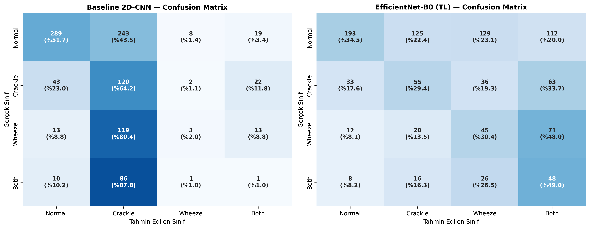

# Solunum Seslerinden Akciğer Patolojilerinin Derin Öğrenme ile Sınıflandırılması

[](https://colab.research.google.com/drive/1vxkc3RD-QfpDNocGx3YC2vuEjy4DTytX?usp=sharing)


Dijital stetoskop ses kayıtlarından ayrıştırılan solunum döngülerini **Log-Mel Spektrogram** temsillerine dönüştürerek **Normal**, **Crackle (Ral)**, **Wheeze (Hırıltı)** ve **Both (Ral + Hırıltı)** olmak üzere 4 akustik sınıfı tespit eden karşılaştırmalı derin öğrenme çalışmasıdır.

---

## 1. Veri Seti ve Ön İşleme Akışı

* **Veri Kaynağı:** [ICBHI 2017 Respiratory Sound Database (Kaggle)](https://www.kaggle.com/datasets/vbookshelf/respiratory-sound-database)
* **Kapsam:** 126 hastaya ait 920 `.wav` kaydı ve 920 `.txt` anotasyon dosyasından çıkarılan **6.898 solunum döngüsü** (`Normal: 3.642`, `Crackle: 1.864`, `Wheeze: 886`, `Both: 506`).
* **Sinyal İşleme ve Temsil:**
  * Tüm kayıtlar `16 kHz` örnekleme hızına standardize edildi.
  * Döngü süreleri dağılımına (%90 yüzdelik dilim = `4,11 sn`) göre tüm döngüler **4,0 saniyelik** sabit pencereye (`64.000` örnek) sıfır doldurma / kırpma ile getirildi.
  * `librosa` ile `(128, 126, 3)` boyutunda Min-Max normalize edilmiş **Log-Mel Spektrogram** tensörleri üretildi.
* **Veri Sızıntısı (Data Leakage) Önlemi:** Aynı hastanın farklı solunum döngülerinin hem eğitim hem test setine düşmesini engellemek için `GroupShuffleSplit` ile **hasta bazlı (%70 Eğitim / %15 Doğrulama / %15 Test)** ayrım uygulandı.


---

## 2. Model Mimarileri ve Karşılaştırmalı Sonuçlar

Sınıf dengesizliğini gidermek için eğitim sürecinde ters frekans tabanlı `class_weight` uygulanmış ve bağımsız test seti (`N = 992` döngü) üzerinde iki mimari kıyaslanmıştır:

| Model Mimarisi | Accuracy | Macro Precision | Macro Recall | Macro F1-Score | ROC-AUC (OvR) |
| :--- | :---: | :---: | :---: | :---: | :---: |
| **Baseline 2D-CNN (Sıfırdan)** | 0.4163 | 0.3145 | 0.2973 | 0.2501 | 0.6359 |
| **EfficientNet-B0 (Transfer Learning)** | 0.3438 | **0.3483** | **0.3583** | **0.3079** | **0.6448** |

### Temel Bulgular
* **Azınlık Sınıf Duyarlılığı:** Baseline 2D-CNN tahminlerini çoğunluk sınıflarına (`Normal` ve `Crackle`) yoğunlaştırırken, iki aşamalı (Feature Extraction + Fine-Tuning) eğitilen **EfficientNet-B0** modeli `Both` sınıfı duyarlılığını (Recall) `%1,0`'den **`%49,0`'a**, `Wheeze` duyarlılığını ise `%2,0`'den **`%30,4`'e** yükseltmiştir.
* **Hata Analizi:** Yüksek güvenle yanlış tahmin edilen örneklerin incelenmesi sonucunda, 1,5 saniyeden kısa solunum döngülerindeki sıfır doldurma (zero-padding) oranının ve düşük frekanslı stetoskop sürtünme gürültülerinin temel hata kaynakları olduğu belirlenmiştir.




---

## 3. Depo Yapısı

```text
├── assets/                                              # EDA, eğitim eğrileri, confusion matrix ve hata analizi grafikleri
├── Solunum_Seslerinden_Patoloji_Siniflandirmasi.ipynb   # Uçtan uca Google Colab deney notebook dosyası
└── README.md                                            # Proje özeti ve deneysel sonuç dokümantasyonu
```

---

## 4. Geliştirme Önerileri

1. **SpecAugment Veri Artırma:** Eğitim sırasında azınlık sınıflara zaman ve frekans maskeleme uygulanması.
2. **Bant Geçiren Filtreleme:** Akciğer seslerinin klinik bilgi taşıdığı `100 Hz – 2.000 Hz` aralığını koruyan Butterworth filtresi ile kalp ve sürtünme gürültüsünün bastırılması.
3. **Hibrit CRNN Mimarisi:** Spektral özellik çıkarımı yapan konvolüsyon katmanlarının ardına zamansal sürekliliği yakalayan `BiGRU` katmanlarının eklenmesi.
