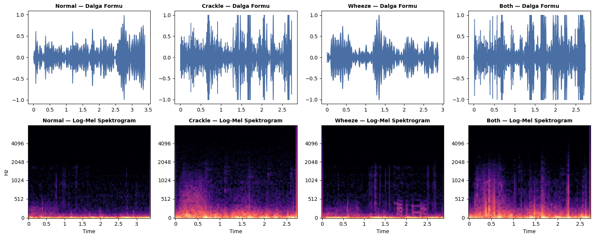

# Solunum Seslerindeki Akustik Örüntülerin CNN ve EfficientNet-B0 ile Sınıflandırılması

[](https://colab.research.google.com/github/esra03-1/icbhi-respiratory-sound-classification/blob/main/Solunum_Seslerinden_Patoloji_Siniflandirmasi.ipynb)


Dijital stetoskop ses kayıtlarından ayrıştırılan solunum döngülerini **Log-Mel Spektrogram** temsillerine dönüştürerek **Normal**, **Crackle (Ral)**, **Wheeze (Hırıltı)** ve **Both (Ral + Hırıltı)** olmak üzere 4 akustik sınıfı tespit eden karşılaştırmalı derin öğrenme çalışmasıdır.

> **Sürüm notu:** Notebook inceleme sonrasında düzenlendi; aşağıdaki skorlar ve `assets/` görselleri **önceki deneye** aittir. Düzenlenmiş kod yeniden çalıştırıldıktan sonra birlikte güncellenmelidir. Bu sürüm için yeni performans iddiası yapılmamaktadır.
>
> Model hastalık tanısı üretmez. Normal etiketi sağlıklı kişi anlamına gelmez; klinik kullanım doğrulaması yapılmamıştır.

---

## 1. Veri Seti ve Ön İşleme Akışı

* **Veri Kaynağı:** [ICBHI 2017 Respiratory Sound Database (Kaggle)](https://www.kaggle.com/datasets/vbookshelf/respiratory-sound-database)
* **Kapsam:** 126 hastaya ait 920 `.wav` kaydı ve 920 `.txt` anotasyon dosyasından çıkarılan **6.898 solunum döngüsü** (`Normal: 3.642`, `Crackle: 1.864`, `Wheeze: 886`, `Both: 506`).
* **Sinyal İşleme ve Temsil:**
  * Tüm kayıtlar `16 kHz` örnekleme hızına standardize edildi.
  * Döngü süreleri dağılımına (%90 yüzdelik dilim = `4,11 sn`) dayanan önceki deneyde tüm döngüler **4,0 saniyelik** sabit pencereye (`64.000` örnek) sıfır doldurma / kırpma ile getirildi.
  * `librosa` ile `(128, 126, 3)` boyutunda Min-Max normalize edilmiş **Log-Mel Spektrogram** tensörleri üretildi.
* **Kullanılan örnekler (önceki deney):** `duration < 0,2 sn` filtresinden sonra 6.897 döngü: 4.915 eğitim, 990 doğrulama, 992 test.
* **Veri Sızıntısı (Data Leakage) Önlemi:** Aynı hastanın farklı solunum döngülerinin hem eğitim hem test setine düşmesini engellemek için `GroupShuffleSplit` ile **hasta bazlı (88 eğitim / 19 doğrulama / 19 test hastası)** ayrım uygulandı. Hedef oranlar hasta grupları içindir; döngü oranları tam %70/%15/%15 değildir. Resmi challenge bölmesi kullanılmamıştır.




---

## 2. Model Mimarileri ve Karşılaştırmalı Sonuçlar

Sınıf dengesizliğinin eğitim kaybındaki etkisini azaltmak için eğitim sürecinde ters frekans tabanlı `class_weight` uygulanmış ve bağımsız test seti (`N = 992` döngü) üzerinde iki mimari kıyaslanmıştır:

| Model Mimarisi | Accuracy | Macro Precision | Macro Recall | Macro F1-Score | ROC-AUC (OvR) |
| :--- | :---: | :---: | :---: | :---: | :---: |
| **Baseline 2D-CNN (Sıfırdan)** | 0.4163 | 0.3145 | 0.2973 | 0.2501 | 0.6359 |
| **EfficientNet-B0 (Transfer Learning)** | 0.3438 | **0.3483** | **0.3583** | **0.3079** | **0.6448** |

### Temel Bulgular
* **Azınlık Sınıf Duyarlılığı:** Baseline 2D-CNN tahminlerini çoğunluk sınıflarına (`Normal` ve `Crackle`) yoğunlaştırırken, iki aşamalı (Feature Extraction + Fine-Tuning) eğitilen **EfficientNet-B0** modeli `Both` sınıfı duyarlılığını (Recall) `%1,0`'den **`%49,0`'a**, `Wheeze` duyarlılığını ise `%2,0`'den **`%30,4`'e** yükseltmiştir.
* **Karşılık gelen kayıplar:** Normal Recall yaklaşık %51,7 → %34,5 gerilemiştir. EfficientNet Both Precision yaklaşık %16'dır. Azınlık Recall artışı tek başına güvenilirlik göstermez.
* **Basit referans:** Her örneğe eğitimdeki çoğunluk sınıfı Normal diyen model testte `559/992 = %56,35 accuracy`, `0,1802 Macro F1` alır. İki DL modeli accuracy bakımından bu referansın altında, Macro F1 bakımından üstündedir.
* **Hata Analizi:** Yüksek skorlu dört hatada dolgu alanları ve alt frekans enerjisi gözlenmiştir. Dolgu ve gürültünün nedensel etkisi henüz karşılaştırmalı deneyle doğrulanmamıştır.
* **Sınırlılık:** Tek hasta bölmesi ve tek eğitim, genelleme veya klinik güvenilirlik kanıtlamaz. Test örnekleri hata analizi için incelenmiştir; sonraki geliştirmeler için bağımsız nihai değerlendirme gerekir.


---

## 3. Depo Yapısı

```text
assets/                         # Önceki deneyin altı grafiği; tekrar çalıştırmada güncellenir
Solunum_Seslerinden_Patoloji_Siniflandirmasi.ipynb
requirements-colab.txt           # Colab için bağımlılık aralıkları
docs/INCELEME_VE_DUZELTMELER.md  # Bulgular ve düzeltme gerekçeleri
docs/DOGRULAMA.md                # Çalıştırılan kontroller ve kapsamı
README.md
.gitignore
```

---

## 4. Colab'da çalıştırma

1. Notebook'u Colab'a yükleyin veya depodaki sürümü Colab ile açın; T4 GPU seçin.
2. Hücreleri baştan sona çalıştırın. Kaggle'dan aldığınız `kaggle.json` dosyasını yalnızca oturuma yükleyin.
3. Yaklaşık 3,7 GB veri indirme ve açma için yeterli disk alanı ayırın.
4. Hasta kesişimi ve sınıf sayısı kontrollerini inceleyin. Modeller ve eğitim geçmişleri `artifacts/` altında kaydedilir.
5. `artifacts/model_comparison.csv`, sınıf raporları ve yeni grafiklerle raporu güncelleyin.

`requirements-colab.txt` bağımlılık aralıklarını verir; tam sürüm kilidi değildir. Gerçek sürümler çalıştırmada kaydedilir.
Yeni notebook her iki EfficientNet aşamasını doğrulama kaybıyla karşılaştırır, ön eğitimli BatchNormalization istatistiklerini korur.
[Detaylı inceleme](docs/INCELEME_VE_DUZELTMELER.md) ve [doğrulama kapsamı](docs/DOGRULAMA.md).
Colab rozeti depodaki sürümü açar; yerel düzenlemeler GitHub'a yüklenince o sürüme erişilir.

## 5. Geliştirme Önerileri

1. **SpecAugment Veri Artırma:** Eğitim sırasında azınlık sınıflara zaman ve frekans maskeleme uygulanması.
2. **Bant Geçiren Filtreleme:** `100 Hz – 2.000 Hz` Butterworth filtresini eğitim/doğrulamada karşılaştırmak; yararlı ses bileşenlerini kaybetme olasılığını ölçmek.
3. **Hibrit CRNN Mimarisi:** Spektral özellik çıkarımı yapan konvolüsyon katmanlarının ardına zamansal sürekliliği yakalayan `BiGRU` katmanlarının eklenmesi.


## Kaynak ve kullanım koşulları

- Özgün veri: https://bhichallenge.med.auth.gr/
- Dağıtım: https://www.kaggle.com/datasets/vbookshelf/respiratory-sound-database
- Keras: https://keras.io/guides/transfer_learning/
- EfficientNet: https://keras.io/api/applications/efficientnet/efficientnet_models/

Veri ve ön eğitimli ağırlıkların koşulları kendi kaynaklarından kontrol edilmelidir. Kaggle erişim dosyası, ham veri ve model dosyaları depoya eklenmez.
